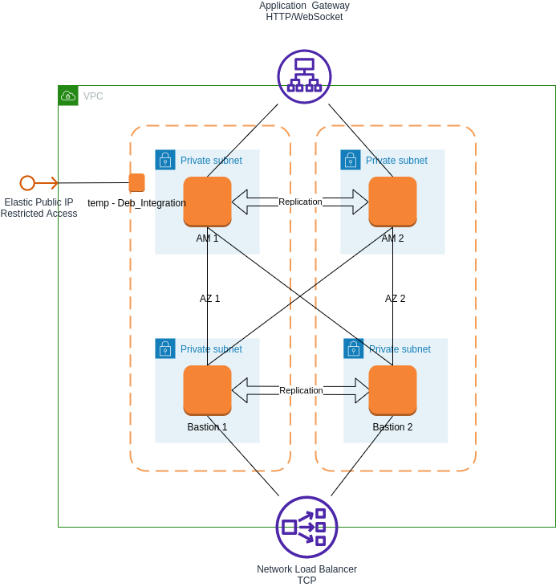

<!-- markdownlint-disable MD033 -->
# Deploy WALLIX Access Manager and Session Manager (Bastion) clusters with loadbalancer on AWS

## Introduction

This is an example of AWS deployment with cluster setup.
It contains mutiples modules to help understands the steps of creation.
Those modules can be use as standalone, therefore contains their own README ( look at them to find extra tweaks & tricks you can do :p. )

This example is intended to present good practices but keeping the ease of use in mind, so fine for lab. If you intend to use it in production please adapt it.



## Table of Content

- [Deploy WALLIX Access Manager and Session Manager (Bastion) clusters with loadbalancer on AWS](#deploy-wallix-access-manager-and-session-manager-bastion-clusters-with-loadbalancer-on-aws)
  - [Introduction](#introduction)
  - [Table of Content](#table-of-content)
  - [What to check before starting ?](#what-to-check-before-starting-)
  - [Deploy](#deploy)
  - [Configure](#configure)
  - [Network access](#network-access)
  - [Replication](#replication)
  - [Cost](#cost)
  - [Known issues](#known-issues)
    - [Debian Terms and Conditions not accepted](#debian-terms-and-conditions-not-accepted)
    - [Failing to import certificate on loadbalancer](#failing-to-import-certificate-on-loadbalancer)
    - [I can't access the Debian Machine from my IP](#i-cant-access-the-debian-machine-from-my-ip)
  - [Requirements](#requirements)
  - [Resources](#resources)
  - [Inputs](#inputs)
  - [Outputs](#outputs)

## What to check before starting ?

- Access and Right to AWS
- AMI were shared by WALLIX Support if the versions you want to test are not available on MarketPlace.
- terraform is installed

Adapt samples to your needs, ( Make sure to change the allowed-ips)

```shell
cp lab.auto.tfvars.example lab.auto.tfvars
vi lab.auto.tfvars
```

## Deploy

```shell
terraform init              # initializes the working directory
terraform fmt --recursive   # format files
terraform validate          # validates the configuration files
terraform apply             # apply configuration
```

Some outputs are marked as sensible. Example: `sm_password_wabadmin = <sensitive>`

Use `terraform output <name of the output>` to show them. Example :`terraform output sm_password_wabadmin`

Key outputs include:

- **am_url_alb**: URL to access the Access Manager cluster via Application Load Balancer.
- **sm_fqdn_nlb**: FQDN to access the Session Manager cluster via Network Load Balancer.
- **debian_connect**: SSH/RDP connection details for the integration Debian instance.
- **am_password_wabadmin**, **sm_password_wabadmin**: Sensitive admin passwords for Access Manager and Session Manager.
- **ssh_private_key**: Generated SSH private key for instance access.
- **all_ips**, **all_secrets**: Lists of IPs and secrets generated during deployment.

Refer to the [Outputs](#outputs) section below for a complete list and descriptions.

## Configure

Connect to the integration host by ssh.

There is restriction set for appliance configuration and global organisation on both AM throught LoadBalancer rules and not HTTPS access to Session Manager from outside the VPC.

Use `rdpuser` to connect to the debian integration's instance with RDP. The private key is copied to the user so you can access WALLIX Target on admin interface with it.

You can also use x11 forwarding and run firefox on the Debian Host to access it.

```bash
ssh -Xi ./generated_files/private_key.pem admin@<ip_debian_host>
admin# firefox
```

Connect and configure Access and Session Manager on port 2242 :

- The following setup are not yet automated :
  - Database replication
  - WebUI Admin password and Encryption.

## Network access

The ALB and the NLB accept traffic from `allowed_ips` and from the VPC CIDR only. When the ALB is internet-facing (`alb_internal = false`, the default), the public IP of the Debian host is also allowed, so its Firefox can reach the Access Manager through the ALB.

The Access Managers accept HTTPS from the ALB security group and from the VPC subnets. The NLB preserves client IPs, so the Bastion security group allows SSH, RDP and HTTPS from the NLB security group. The VPC default security group, which the AM and SM interfaces also carry, only allows traffic between its members.

## Replication

If there is 2 Session Manager, a file `./generated_files/info_replication.txt` will be generated. This can be used for extra automation on setting up the replication.
This is not yet shown as an example as bastion replication installation is dependant on the version you use.

## Cost

This estimate predates the root volume change: each WALLIX instance now has a single encrypted root volume of `am_disk_size` or `sm_disk_size` GB (`am_disk_type`/`sm_disk_type`), so the 8 GB gp2 `root_block_device` lines no longer apply to them.

```txt
 Name                                                       Monthly Qty  Unit              Monthly Cost   
                                                                                                          
 module.instance_bastion[0].aws_instance.wallix                                                           
 ├─ Instance usage (Linux/UNIX, on-demand, t3.medium)               730  hours                   $33.29   
 ├─ root_block_device                                                                                     
 │  └─ Storage (general purpose SSD, gp2)                             8  GB                       $0.88   
 └─ ebs_block_device[0]                                                                                   
    └─ Storage (general purpose SSD, gp3)                            31  GB                       $2.73   
                                                                                                          
 module.instance_bastion[1].aws_instance.wallix                                                           
 ├─ Instance usage (Linux/UNIX, on-demand, t3.medium)               730  hours                   $33.29   
 ├─ root_block_device                                                                                     
 │  └─ Storage (general purpose SSD, gp2)                             8  GB                       $0.88   
 └─ ebs_block_device[0]                                                                                   
    └─ Storage (general purpose SSD, gp3)                            31  GB                       $2.73   
                                                                                                          
 module.instance_access_manager[0].aws_instance.wallix                                                    
 ├─ Instance usage (Linux/UNIX, on-demand, t3.medium)               730  hours                   $33.29   
 ├─ root_block_device                                                                                     
 │  └─ Storage (general purpose SSD, gp2)                             8  GB                       $0.88   
 └─ ebs_block_device[0]                                                                                   
    └─ Storage (general purpose SSD, gp3)                            30  GB                       $2.64   
                                                                                                          
 module.instance_access_manager[1].aws_instance.wallix                                                    
 ├─ Instance usage (Linux/UNIX, on-demand, t3.medium)               730  hours                   $33.29   
 ├─ root_block_device                                                                                     
 │  └─ Storage (general purpose SSD, gp2)                             8  GB                       $0.88   
 └─ ebs_block_device[0]                                                                                   
    └─ Storage (general purpose SSD, gp3)                            30  GB                       $2.64   
                                                                                                          
 module.instance_access_manager[2].aws_instance.wallix                                                    
 ├─ Instance usage (Linux/UNIX, on-demand, t3.medium)               730  hours                   $33.29   
 ├─ root_block_device                                                                                     
 │  └─ Storage (general purpose SSD, gp2)                             8  GB                       $0.88   
 └─ ebs_block_device[0]                                                                                   
    └─ Storage (general purpose SSD, gp3)                            30  GB                       $2.64   
                                                                                                          
 module.integration_debian[0].aws_instance.debian_admin                                                   
 ├─ Instance usage (Linux/UNIX, on-demand, t3.medium)               730  hours                   $33.29   
 └─ root_block_device                                                                                     
    └─ Storage (general purpose SSD, gp2)                             8  GB                       $0.88   
                                                                                                          
 aws_lb.front_am                                                                                          
 ├─ Application load balancer                                       730  hours                   $18.40   
 └─ Load balancer capacity units                         Monthly cost depends on usage: $5.84 per LCU     
                                                                                                          
 aws_lb.front_sm                                                                                          
 ├─ Network load balancer                                           730  hours                   $18.40   
 └─ Load balancer capacity units                         Monthly cost depends on usage: $4.38 per LCU     
                                                                                                          
 OVERALL TOTAL                                                                                 $255.18 
```

## Known issues

### Debian Terms and Conditions not accepted

You must accept [terms and condition of Debian 12](https://aws.amazon.com/marketplace/pp/prodview-g5rooj5oqzrw4) before use of this template.

### Failing to import certificate on loadbalancer

For some reason, there is sometimes a 403 error while importing a certificate on the LB listener. This is generally due to MFA setup on the account used, and is linked to the rights to access the certificate's vault, as the vault function uses `assume_role`. Please read: [Github issue](https://github.com/hashicorp/terraform-provider-aws/issues/2420).

You may need to manually create the listener and import it before refreshing and re-applying the configuration.

```bash
terraform import aws_lb_listener.Frontend_AM arn:aws:elasticloadbalancing:<region>:<account-id>:listener/app/<alb-name>/<alb-id>/<listener-id>
```

If you have imported the listener for the port 80 by mistake, delete the resource target and redo the import.

```bash
terraform destroy -target aws_lb_listener.Frontend_AM
terraform import aws_lb_listener.Frontend_AM arn:aws:elasticloadbalancing:<region>:<account-id>:listener/app/<alb-name>/<alb-id>/<listener-id>
```

### I can't access the Debian Machine from my IP

Have you set the allowed ip variable with your public IP ?

Terraform itself connects to the Debian host over SSH to copy the bookmarks and the replication file, so `allowed_ips` must also include the public IP of the machine running Terraform (see the `your-public_ip` output).

<!-- BEGIN_TF_DOCS -->
## Requirements

| Name | Version |
| ---- | ------- |
| terraform | >= 1.9.0 |
| aws | ~> 6.0 |
| cloudinit | >=2.3.5 |
| http | >=3.4.5 |
| local | >=2.5.2 |
| random | >=3.6.3 |
| ssh | >=2.7.0 |
| tls | >=4.0.6 |

## Resources

| Name | Type |
| ---- | ---- |
| [aws_acm_certificate.cert](https://registry.terraform.io/providers/hashicorp/aws/latest/docs/resources/acm_certificate) | resource |
| [aws_default_security_group.default](https://registry.terraform.io/providers/hashicorp/aws/latest/docs/resources/default_security_group) | resource |
| [aws_efs_file_system.efs-example](https://registry.terraform.io/providers/hashicorp/aws/latest/docs/resources/efs_file_system) | resource |
| [aws_efs_mount_target.efs_mount_target](https://registry.terraform.io/providers/hashicorp/aws/latest/docs/resources/efs_mount_target) | resource |
| [aws_internet_gateway.cluster_gateway](https://registry.terraform.io/providers/hashicorp/aws/latest/docs/resources/internet_gateway) | resource |
| [aws_lb.front_am](https://registry.terraform.io/providers/hashicorp/aws/latest/docs/resources/lb) | resource |
| [aws_lb.front_sm](https://registry.terraform.io/providers/hashicorp/aws/latest/docs/resources/lb) | resource |
| [aws_lb_listener.Frontend_AM](https://registry.terraform.io/providers/hashicorp/aws/latest/docs/resources/lb_listener) | resource |
| [aws_lb_listener.HTTP_to_HTTPS_Redirect](https://registry.terraform.io/providers/hashicorp/aws/latest/docs/resources/lb_listener) | resource |
| [aws_lb_listener.front_end_HTTPS](https://registry.terraform.io/providers/hashicorp/aws/latest/docs/resources/lb_listener) | resource |
| [aws_lb_listener.front_end_RDP](https://registry.terraform.io/providers/hashicorp/aws/latest/docs/resources/lb_listener) | resource |
| [aws_lb_listener.front_end_SSH](https://registry.terraform.io/providers/hashicorp/aws/latest/docs/resources/lb_listener) | resource |
| [aws_lb_listener_rule.redirect](https://registry.terraform.io/providers/hashicorp/aws/latest/docs/resources/lb_listener_rule) | resource |
| [aws_lb_target_group.front_am](https://registry.terraform.io/providers/hashicorp/aws/latest/docs/resources/lb_target_group) | resource |
| [aws_lb_target_group.front_bastion_https](https://registry.terraform.io/providers/hashicorp/aws/latest/docs/resources/lb_target_group) | resource |
| [aws_lb_target_group.front_bastion_rdp](https://registry.terraform.io/providers/hashicorp/aws/latest/docs/resources/lb_target_group) | resource |
| [aws_lb_target_group.front_bastion_ssh](https://registry.terraform.io/providers/hashicorp/aws/latest/docs/resources/lb_target_group) | resource |
| [aws_lb_target_group_attachment.attach_am](https://registry.terraform.io/providers/hashicorp/aws/latest/docs/resources/lb_target_group_attachment) | resource |
| [aws_lb_target_group_attachment.attach_sm_https](https://registry.terraform.io/providers/hashicorp/aws/latest/docs/resources/lb_target_group_attachment) | resource |
| [aws_lb_target_group_attachment.attach_sm_rdp](https://registry.terraform.io/providers/hashicorp/aws/latest/docs/resources/lb_target_group_attachment) | resource |
| [aws_lb_target_group_attachment.attach_sm_ssh](https://registry.terraform.io/providers/hashicorp/aws/latest/docs/resources/lb_target_group_attachment) | resource |
| [aws_network_interface_sg_attachment.wallix-am](https://registry.terraform.io/providers/hashicorp/aws/latest/docs/resources/network_interface_sg_attachment) | resource |
| [aws_network_interface_sg_attachment.wallix-sm](https://registry.terraform.io/providers/hashicorp/aws/latest/docs/resources/network_interface_sg_attachment) | resource |
| [aws_route.default_route](https://registry.terraform.io/providers/hashicorp/aws/latest/docs/resources/route) | resource |
| [aws_security_group.accessmanager_sg](https://registry.terraform.io/providers/hashicorp/aws/latest/docs/resources/security_group) | resource |
| [aws_security_group.alb](https://registry.terraform.io/providers/hashicorp/aws/latest/docs/resources/security_group) | resource |
| [aws_security_group.bastion_sg](https://registry.terraform.io/providers/hashicorp/aws/latest/docs/resources/security_group) | resource |
| [aws_security_group.efs_sg](https://registry.terraform.io/providers/hashicorp/aws/latest/docs/resources/security_group) | resource |
| [aws_security_group.nlb](https://registry.terraform.io/providers/hashicorp/aws/latest/docs/resources/security_group) | resource |
| [aws_subnet.subnet_az_AM](https://registry.terraform.io/providers/hashicorp/aws/latest/docs/resources/subnet) | resource |
| [aws_subnet.subnet_az_SM](https://registry.terraform.io/providers/hashicorp/aws/latest/docs/resources/subnet) | resource |
| [aws_vpc.cluster](https://registry.terraform.io/providers/hashicorp/aws/latest/docs/resources/vpc) | resource |
| [local_file.firefox_bookmark_am](https://registry.terraform.io/providers/hashicorp/local/latest/docs/resources/file) | resource |
| [local_file.firefox_bookmark_sm](https://registry.terraform.io/providers/hashicorp/local/latest/docs/resources/file) | resource |
| [local_sensitive_file.private_key](https://registry.terraform.io/providers/hashicorp/local/latest/docs/resources/sensitive_file) | resource |
| [local_sensitive_file.replication_master](https://registry.terraform.io/providers/hashicorp/local/latest/docs/resources/sensitive_file) | resource |
| [ssh_resource.copy_bookmarks](https://registry.terraform.io/providers/loafoe/ssh/latest/docs/resources/resource) | resource |
| [ssh_resource.info_replication](https://registry.terraform.io/providers/loafoe/ssh/latest/docs/resources/resource) | resource |
| [tls_private_key.example](https://registry.terraform.io/providers/hashicorp/tls/latest/docs/resources/private_key) | resource |
| [tls_self_signed_cert.example](https://registry.terraform.io/providers/hashicorp/tls/latest/docs/resources/self_signed_cert) | resource |
| [aws_availability_zones.available](https://registry.terraform.io/providers/hashicorp/aws/latest/docs/data-sources/availability_zones) | data source |
| [http_http.myip](https://registry.terraform.io/providers/hashicorp/http/latest/docs/data-sources/http) | data source |

## Inputs

| Name | Description | Type | Default | Required |
| ---- | ----------- | ---- | ------- | :------: |
| access\_manager\_version | Access Manager version to use. It can be partial or full value (5, 4.0 , 4.4.1, 4.4.1.8).  Can be empty for latest pushed image. | `string` | `""` | no |
| alb\_internal | Should Application Load Balancer be internal ?  If false, the AM web UI is reachable from allowed\_ips over the Internet. | `bool` | `false` | no |
| allowed\_ips | Public CIDR blocks allowed to reach the ALB, the NLB and the integration instance, e.g: ["203.0.113.10/32"]. The VPC CIDR is always allowed on the load balancers. | `list(string)` | n/a | yes |
| am\_disk\_size | AM disk sizing | `number` | `30` | no |
| am\_disk\_type | AM disk type | `string` | `"gp3"` | no |
| ami\_from\_aws\_marketplace | Should we use the marketplace image ? If false, the shared image by WALLIX will be use. | `bool` | `true` | no |
| aws\_instance\_size\_am | Specifies the instance sizing. | `string` | `"t2.medium"` | no |
| aws\_instance\_size\_debian | Specifies the instance sizing. | `string` | `"t3.medium"` | no |
| aws\_instance\_size\_sm | Specifies the instance sizing. | `string` | `"t2.medium"` | no |
| aws\_profile | AWS profile to use! | `string` | `"default"` | no |
| aws\_region | Aws region to deploy resources | `string` | n/a | yes |
| bastion\_version | Bastion version to use. It can be partial or full value (12, 11.0 , 10.4.3, 10.0.7.28).  Can be empty for latest pushed image. | `string` | `""` | no |
| deploy\_integration\_debian | Should a debian instance for integration be deployed ? | `bool` | `true` | no |
| install\_replication | Should we install replication on Session Manager ?  Only valid for bastion 12.0.0 and above. | `bool` | `false` | no |
| key\_pair\_name | Name of the key pair that will be use to connect to the instance. | `string` | n/a | yes |
| nlb\_internal | Should Network Load Balancer be internal ?  Setting it to false is risky. | `bool` | `true` | no |
| number\_of\_am | Number of AM to be deployed | `number` | `2` | no |
| number\_of\_sm | Number of SM to be deployed | `number` | `2` | no |
| project\_name | Specifies the project name. Load balancer and target group names derive from it and are limited to 32 characters. | `string` | n/a | yes |
| sm\_disk\_size | SM disk sizing | `number` | `31` | no |
| sm\_disk\_type | SM disk type | `string` | `"gp3"` | no |
| tags | Map of tags to apply on resources. | `map(string)` | `{}` | no |
| vpc\_cidr | The CIDR block for the VPC, e.g: 10.0.0.0/16. Prefix between /16 and /22 (subnets use 6 extra bits). | `string` | n/a | yes |

## Outputs

| Name | Description |
| ---- | ----------- |
| all\_ips | All IPs |
| all\_secrets | All secret |
| am-ami | Description of the AMI used for Access Manager. |
| am\_password\_wabadmin | Wabadmin password. |
| am\_password\_wabsuper | Wabsuper password. |
| am\_password\_wabupgrade | Wabupgrade password. |
| am\_private\_ip | List of the private ip used for Access Manager. |
| am\_url\_alb | Url to connect to the AM cluster from Application Load Balancer. |
| availability\_zones | Availability zones of the select region. |
| cloud\_init\_am | Show Cloud-init rendered file for AM |
| cloud\_init\_sm | Show Cloud-init rendered file for SM |
| debian\_connect | How to connect to the Debian instance. |
| debian\_public\_ip | Public IP of the Debian instance. |
| debianpassword\_rdpuser | Generated password for rdp connexion with rdpuser. |
| efs | FQDN of the EFS |
| sm-ami | Description of the AMI used for Session Manager. |
| sm\_fqdn\_nlb | FQDN of the Network Load Balancer. |
| sm\_ids | List of sm ids. Useful to find the default admin password (admin-<instance-id>) |
| sm\_password\_crypto | Bastion passphrase. |
| sm\_password\_wabadmin | Wabadmin password. |
| sm\_password\_wabsuper | Wabsuper password. |
| sm\_password\_wabupgrade | Wabupgrade password. |
| sm\_password\_webui | WebUI password. |
| sm\_private\_ip | List of the private ip used for Session Manager. |
| ssh\_private\_key | The SSH Private key in openssh format. |
| warning\_allowed\_ips\_too\_wild | IP Warnings. |
| warning\_nlb\_internal\_false | NLB Warnings. |
| your-public\_ip | Your egress public IP. |
<!-- END_TF_DOCS -->